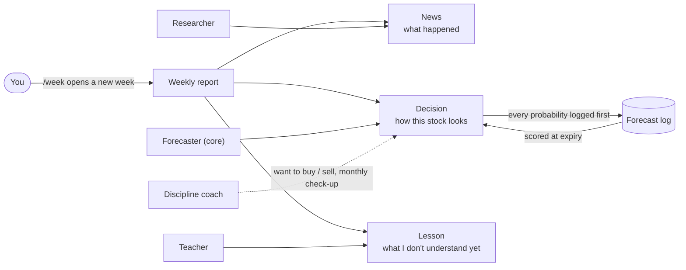

# Finclaude

**English** | [简体中文](README.zh-CN.md)

[](https://github.com/seanyi0104/Finclaude/actions/workflows/tests.yml)
[](LICENSE)

**A personal investment-research agent built on Claude Code: every number has a source, every forecast can be checked, and every decision stays yours.**

Finclaude turns [Claude Code](https://claude.com/claude-code) into a weekly research assistant for a retail investor. Claude fetches the data and does the maths in Python; probabilities come only from data and models, are logged before the outcome is known, and are scored when they expire. News comes only from official sources, the broker connection is read-only, and reminders follow the investor's own written rules. The assistant replies in Chinese and covers US, Hong Kong and Australian (ASX) markets.

For education only, not investment advice; the decision is yours.

## The problem it addresses

People new to investing tend to hit the same three problems: there is too much information and no way to tell what to trust; analysis stops at indicators and never reaches a decision; and a general-purpose AI gives judgements with no source that cannot be checked afterwards. Finclaude's answer:

- **Traceable information**: news comes only from original official sources (SEC EDGAR, the Federal Reserve, BLS, BEA, company investor-relations pages), each item with its link; every number names its data provider and date.
- **Testable forecasts**: probabilities come only from data and models, never from numbers the AI estimates; each one is logged before the outcome is known and scored with the Brier score at expiry, against a coin flip that always says 50%.
- **Decisions stay with you**: no buy or sell instructions and read-only broker access; discipline reminders follow your own investment policy statement (IPS), and whether to act is up to you.

## A week with Finclaude: three pages, four roles

You read three pages a week: **News** (what happened), **Decision** (how this stock looks) and **Lesson** (what I don't understand yet). Four roles write them; the discipline coach steps in only when you say you want to buy or sell, and at the monthly check-up.



- **News** (researcher): the first time you speak each day, it catches up to the latest trading day. Day to day it checks a fixed list: 8-K filings at the SEC for watchlist companies, the day's BLS / BEA / Federal Reserve releases, and one line each for VIX and VXN (official Cboe closes).
- **Decision** (forecaster): whenever a stock comes up, a single-screen card with a one-sentence conclusion, the probability of a higher price and the range over 2 weeks / 1 month / 3 months / 6 months, reference price levels, market sentiment, the next event and one line of fundamentals. The probabilities are logged at the same time.
- **Lesson** (teacher): wherever you ask a question, it answers briefly there and records the question as a knowledge or research card for the week; you mark each card "got it / partly / not yet", and anything not yet understood is explained differently next time.
- **Discipline guardrail** (discipline coach): your first session starts with a questionnaire that builds your investor profile and investment policy statement (IPS). After that, the monthly check-up and every "I want to buy / sell" are checked against your rules; "everyone is buying" triggers a herd-buying check first, and then a devil's-advocate subagent looks for the strongest arguments against.

## The 11 skills: which one, when

A skill is a written procedure for one situation. Type the slash command, or say something that matches, and Claude uses it. Chinese prompts work just as well: each skill file lists the Chinese phrases that trigger it.

| Role | Skill | When you say |
|---|---|---|
| Weekly switch | `/week` | "Start a new week", "wrap up this week": wraps up last week (holdings review, scoring, archive), then opens the new one |
| Forecaster | (just mention a stock) | "How does NVDA look from here?": a single-screen Decision card |
| Forecaster | `/forecast` | "Make forecast cards", "how do these look from here?": cards for several tickers at once |
| Forecaster | `/sector-pick` | "Which sector is strong lately?": relative strength of the 11 sector ETFs; Jev gives probabilities, checked against a rule-based baseline |
| Forecaster | `/etf-pick` | "Which of these ETFs?": hard filters, then Jev's probabilities against a lowest-fee baseline |
| Researcher | `/why` | "Why did it fall?", "how should I read this news?": facts → mechanism → other explanations → historical analogues → what it means for you |
| Teacher | `/teach` | "Explain…", "what is…", "I don't get it": a one-liner, an analogy, real numbers, common misconceptions, a self-test |
| Discipline coach | `/onboard` | "Set up my profile": a questionnaire that writes your profile, IPS and personal settings |
| Discipline coach | `/checkup` | "Check-up": a rule-by-rule check against the IPS, with a stress test and forecast scoring (run by /week in the first week of each month) |
| Discipline coach | `/fomo-check` | "Everyone is buying", "a friend made money": a herd-buying check, then a devil's-advocate review |
| Discipline coach | `/allocate` | "Backtest", "compare allocations": historical backtests and scenario simulations of candidate allocations |
| Discipline coach | `/overlap` | "Do these overlap?": holdings overlap and correlation between funds; Jev decides which to keep |

There is also a devil's-advocate subagent, `devils-advocate`: before a buy or sell decision it acts as an investment-committee member, lists the 3 strongest objections and writes down what would prove you wrong.

The skill files live in `.claude/skills/` and follow the open [Agent Skills](https://agentskills.io) format.

## How a forecast is made

```
multi-source data → quantitative estimates → Jev probability → logged first → scored at expiry
```

1. **Multi-source data**: the account is read-only; US daily prices, option chains, VIX and more come from several providers and are cross-checked (the card's source line says how many items agree and which one does not); if data is missing, the run stops and says what is missing.
2. **Quantitative estimates**: the historical distribution of returns (treating every past day as "today" and counting how often the price was higher after the same number of days, over all history, the last 10 years, and days in the same trend state), plus the implied volatility and range backed out from option prices.
3. **Jev probability**: [Jev](https://typesafe.ai/blog/introducing-system-one-models-and-jev) is TypeSafe AI's probability model, called through Vercel AI Gateway; it gives probabilities over a fixed set of options only. If it returns no probability, the run stops; Claude may not substitute its own words.
4. **Logged first**: before the outcome is known, the ticker, horizon and each source's probability go into `journal/forecasts.csv`; Jev's request and response are archived.
5. **Scored at expiry**: Brier score = (forecast probability − outcome)², with 1 for up and 0 for down; lower is better. Always saying 50% scores 0.25 every time, which is the baseline to beat. Sources are scored separately, never blended into one number.

The limits are stated as well: historical statistics favour the companies that survived; option probabilities are risk-neutral and naturally sit near 50%; cards issued on the same day bet on the same stretch of the market and are not independent samples, so separating sources that differ only slightly takes hundreds of independent forecasts.

## Guardrails written into code, not just into prompts

- **Read-only broker access**: `tests/test_safety.py` scans the whole package on every run and fails if any API that places, changes or cancels orders, or unlocks trading, appears; account numbers never appear in reports.
- **Confirmation before paid calls**: paid Treg endpoints are refused in code until the cost is confirmed (`CostNotApproved`); Jev is called automatically for cards within a USD 1 monthly budget and stops to ask above it.
- **Stop when data is missing**: anything that cannot be fetched is reported as missing, with the reason; no gap-filling and no "about".
- **Numbers come from Python**: Claude does no mental arithmetic and no estimates; every number names its source and as-of date.
- **Privacy**: see "Where your data stays" below.

## Getting started

You need Python 3.12 or later (managed by uv), git and [Claude Code](https://claude.com/claude-code). Windows, macOS and Linux all work; GitHub Actions runs the offline tests on all three.

**1. Install uv**

Windows (PowerShell):

```powershell
powershell -ExecutionPolicy ByPass -c "irm https://astral.sh/uv/install.ps1 | iex"
```

macOS / Linux:

```bash
curl -LsSf https://astral.sh/uv/install.sh | sh
```

**2. Clone the repository and install the dependencies**

```bash
git clone https://github.com/seanyi0104/Finclaude.git
```

```bash
cd Finclaude
```

```bash
uv sync
```

**3. Run the offline tests** (no internet and no keys needed)

```bash
uv run pytest -q -m "not network"
```

**4. Turn on the privacy guard** (it checks automatically before every `git push`)

```bash
git config core.hooksPath .githooks
```

**5. Optional: add API keys.** Copy `.env.example` to `.env` (`.env` is not tracked by git; keys are read only inside Python and never printed):

- `TREG_TOKEN`: [Treg](https://treg.to), a pay-per-call data catalog; US daily prices use its USD 0 Tiingo route. Without it, yfinance is used.
- `AI_GATEWAY_API_KEY`: a [Vercel AI Gateway](https://vercel.com/ai-gateway) key for calling Jev (model `typesafe-ai/jev`, billed per token). Without it, cards say Jev is missing and the other sources work as usual.

**6. Optional: connect a broker.** Install and log in to [Moomoo OpenD](https://www.moomoo.com/download/OpenAPI); Finclaude only reads holdings, cash and trades. Without it, fill in `profile/holdings.csv` by hand.

**7. Open the folder in Claude Code and run `/onboard` first.** The questionnaire creates four files that stay on your computer: `profile/investor_profile.md` (profile), `profile/ips.md` (investment rules), `CLAUDE.local.md` (account, markets, base currency, time zone) and `profile/private_terms.txt` (your private terms).

**8. Day to day:** type `/week` once a week, mention a stock to get a card, and ask about anything you don't understand.

### What works without any API keys

| Feature | Needs | Without it |
|---|---|---|
| US daily prices | Nothing | yfinance; Treg · Tiingo when `TREG_TOKEN` is set |
| Hong Kong and ASX prices, option chains, analyst data | Nothing | yfinance |
| Official VIX and VXN closes | Nothing | Cboe history files |
| Jev probability | `AI_GATEWAY_API_KEY` | The card says Jev is missing; the historical and options sources still work |
| Holdings, cash, trades | Moomoo OpenD (read-only) | Fill in `profile/holdings.csv` by hand |
| Weekly doc | Claude Docs connector | Written as `reports/<week>/News.md`, `Decision.md` and `Lesson.md` |

### Platform notes

- **Windows**: if Python fails when printing Chinese, run `$env:PYTHONUTF8=1` in PowerShell first. Claude Code sessions already set this in `.claude/settings.json`.
- **macOS / Linux**: UTF-8 is the default; nothing extra is needed.
- **Moomoo OpenD**: official builds exist for Windows, macOS and Linux.

## Where your data stays

The public repository holds only code, skills, tests and templates. Everything below stays on your computer, is kept out by `.gitignore`, and is checked by `tests/test_privacy.py`:

- `CLAUDE.local.md`: your account, markets, time zone and lessons. Claude Code reads it right after `CLAUDE.md`.
- `profile/`: profile, IPS, watchlist, glossary marks and holdings snapshots (except the `*.example.md` templates)
- `journal/`: forecast log, decision notes and earnings dates (except `_template.md`)
- `reports/`, `knowledge/`, `data/`: weekly archives, knowledge cards and raw data
- `.env`: API keys

The privacy guard has three layers:

1. The test scans every file to be committed for secrets, personal e-mail addresses and the private terms you list in `profile/private_terms.txt` (names, account figures that identify you).
2. It also checks commit authors and `git config user.email`, so a personal e-mail address cannot slip out with a commit. A GitHub no-reply address is recommended.
3. `.githooks/pre-push` runs the check again before every push. If you also keep a private history, set `git config finclaude.blockedRoot <first commit of the private history>` and no branch built on it can be pushed.

## Project layout

| Path | Contents |
|---|---|
| `CLAUDE.md` | The rules: four roles, iron rules, data priority, output conventions (loaded into every session) |
| `CLAUDE.local.example.md` | Template for personal settings (copy to `CLAUDE.local.md`) |
| `.claude/` | `skills/` the 11 skills · `agents/` the devil's-advocate subagent · `settings.json` permissions |
| `finclaude/` | The Python package: data · account · quote · treg · jev · forecast · analysis · weekly · sessions · glossary · watchlist · metrics · planning · backtest · render |
| `tests/` | The pytest suite; offline and network tests are separate (`-m "not network"` runs only the offline ones) |
| `profile/` | Templates for the profile and the IPS; your real files live here too (not tracked by git) |
| `journal/` | Decision-note template; the forecast log and decision notes (not tracked by git) |
| `.githooks/` | The pre-push privacy check |

## Limitations

- The assistant and its output are in Chinese. The base currency is designed around AUD, and cash and check-ups are converted to AUD; another base currency needs code changes.
- Moomoo OpenAPI is the only broker integration; holdings at other brokers have to be entered by hand.
- No real-time data and no automated trading: holdings and prices are read when you ask, mostly at the close.
- When a card is made during US trading hours, the option range may be missing (prices out of sync); yfinance has no options data for Hong Kong or ASX listings.
- Whether the forecasts are accurate is known only once enough of them have expired and been scored. Until then, Finclaude claims only that it has a mechanism that can be checked.

## Roadmap

- [ ] Decision cards for ASX and Hong Kong stocks
- [ ] Automatic reading of official calendars and filings (SEC EDGAR, earnings dates companies have announced)
- [ ] A pre-order decision-note workflow (drawing on thesis-tracker in [anthropics/financial-services](https://github.com/anthropics/financial-services))
- [ ] Historical replay scoring: replay the historical and options sources month by month over the past decade or so, to build up a sample
- [ ] Evals and trigger tests for the skills (following [agentskills.io](https://agentskills.io))
- [ ] English output (a language switch for the cards and reports)
- [ ] Split up `finclaude/analysis.py`

## Credits and sources

- **chia Y**: Finclaude started from her two articles, [Full Guide - Claude Financial Agent](https://withchia.substack.com/p/how-to-setup-claude-financial-agent) (2026-06-20) and [You Buy Because Other People are Buying](https://withchia.substack.com/p/you-buy-because-other-people-are) (2026-09-29).
  - Taken from her work: the tool set (Claude Code fetches and computes, Jev gives probabilities, Treg supplies pay-per-call data); Claude's division of labour (no opinions, no buy or sell wording, all maths in Python, stop on failure, quote the cost before paid calls); the three prompts for picking a sector, picking an ETF and checking overlap, whose methods and thresholds were adapted into `/sector-pick`, `/etf-pick` and `/overlap`; and the default fund-selection thresholds.
  - Changed in this project: her article explicitly says not to use AI to predict the market. Finclaude makes forecasting its core, but only with probabilities from reproducible data and a dedicated probability model, each one logged and scored at expiry. It also adds read-only broker access, the weekly News / Decision / Lesson report, a questionnaire-based discipline guardrail and the privacy guard.
  - Her articles are © 2026 chia. This repository contains none of her original text, only links and the adapted procedures.
- **Claude Code** (Anthropic): the code and tests were written by Claude Code. The author set the requirements and rules and accepted every change: tests are written before new features, and nothing is committed until they pass. Commits carry `Co-Authored-By: Claude`, which is why GitHub lists Claude as a contributor.
- **Data and services**: [Tiingo](https://www.tiingo.com) (via [Treg](https://treg.to)), [yfinance](https://github.com/ranaroussi/yfinance), [Cboe](https://www.cboe.com), [SEC EDGAR](https://www.sec.gov/edgar), [Moomoo OpenAPI](https://openapi.moomoo.com), and Jev ([TypeSafe AI](https://typesafe.ai), via [Vercel AI Gateway](https://vercel.com/ai-gateway)). Use of their data is subject to each provider's terms; this repository redistributes no data.

## License

[MIT](LICENSE) © 2026 seanyi0104. The software is provided "as is", without warranty of any kind. Finclaude provides information for educational purposes only and does not constitute investment advice; all investment decisions and their consequences are the user's own responsibility.
