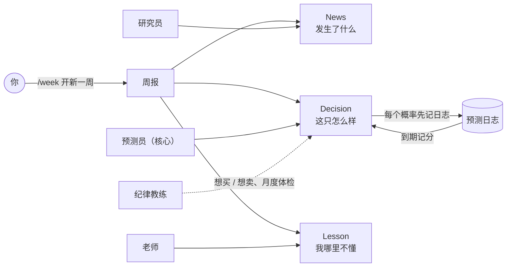

# Finclaude

[](https://github.com/seanyi0104/Finclaude/actions/workflows/tests.yml)
[](LICENSE)

**用 Claude Code 搭的个人投研助手：信息可溯、预测可验、决策自主。**

> **English summary.** Finclaude is a personal investment-research agent built on [Claude Code](https://claude.com/claude-code). Claude fetches data and computes with Python; probabilities come only from data and models (historical statistics, option prices and the Jev probability model), are logged before the outcome is known, and are scored with the Brier score when they expire. News comes from official sources only, the broker connection is read-only, and the investor's own rules (IPS) drive the reminders — the decision always stays with the user. The interface is in Chinese; it covers US, Hong Kong and Australian markets. For education only, not investment advice.

教育用途，非投资建议；决定权在你。

## 它解决什么

刚开始投资的人常遇到三件事：资讯太杂，不知道信哪个；分析停在指标，落不到决定；问通用 AI，它的判断没有出处，事后也没法检验。Finclaude 的做法：

- **信息可溯**：资讯只收官方原文（SEC EDGAR、美联储、BLS、BEA、公司投资者关系页），每条带链接；每个数字标数据商和日期。
- **预测可验**：概率只来自数据和模型，不用 AI 自己估的数；每条概率在结果出来之前先记进日志，到期按 Brier 分数打分，和永远说 50% 的抛硬币比。
- **决策自主**：不给买卖指令，券商账户只读；纪律提醒按你自己写的投资规则（IPS）来，买不买由你定。

## 每周怎么用：三页周报，四个角色

你每周只看三页：**News** 管发生了什么，**Decision** 管这只股票怎么样，**Lesson** 管你哪里不懂。四个角色分别写这三页，纪律教练只在你说想买 / 想卖和每月体检时出场。



- **News**（研究员）：你当天第一次开口时，补到最近一个交易日。平时只查固定清单：关注池公司在 SEC 的 8-K，BLS / BEA / 美联储当天的发布，再加 VIX、VXN 各一行（Cboe 官方收盘）。
- **Decision**（预测员）：聊到哪只股票，就出一屏卡片，内容是一句话结论、2 周 / 1 个月 / 3 个月 / 半年的上涨概率和波动区间、参考价位、市场情绪、下个事件、一句基本面。概率同时记进预测日志。
- **Lesson**（老师）：你在哪里提问，就在哪里先简答，同时记成当周的知识卡或研究卡；你标「懂了 / 半懂 / 不懂」，半懂、不懂的下次换个讲法。
- **纪律护栏**（纪律教练）：第一次使用先做问卷，建立你的投资者画像和投资规则（IPS）；之后每月体检、你说想买 / 想卖时对照规则提醒；听到「大家都在买」先做从众检查，再让反方子代理找最强的反对理由。

## 11 个技能：什么时候用哪个

技能是写好步骤的说明书，一个场景一个。打斜杠命令，或者说到相关的话，就会触发。

| 角色 | 技能 | 你这样说时 |
|---|---|---|
| 每周开关 | `/week` | 「开始新的一周」「本周收尾」：收尾上周（持仓回顾、到期记分、存档），再开新周 |
| 预测员 | 直接聊股票 | 「NVDA 接下来怎么看」：出 Decision 一屏卡片 |
| 预测员 | `/forecast` | 「出预测卡」「这几只接下来怎么看」：一次给多只出卡 |
| 预测员 | `/sector-pick` | 「最近哪个行业强」：11 个行业 ETF 的相对强弱，Jev 给概率，和规则基线对照 |
| 预测员 | `/etf-pick` | 「这几只 ETF 选哪只」：硬门槛过滤后 Jev 给概率，和「费率最低」基线对照 |
| 研究员 | `/why` | 「为什么涨 / 跌」「怎么看这条新闻」：事实 → 机制 → 其他解释 → 历史类比 → 对你的影响 |
| 老师 | `/teach` | 「讲讲」「什么是」「没懂」：一句话、类比、真实数字、常见误区、自测 |
| 纪律教练 | `/onboard` | 「建档」：问卷生成你的画像、IPS 和个人设定 |
| 纪律教练 | `/checkup` | 「体检」：按 IPS 逐条检查，加压力测试和到期记分（每月第一周由 /week 调用） |
| 纪律教练 | `/fomo-check` | 「大家都在买」「朋友赚了」：从众检查，再交给反方子代理复核 |
| 纪律教练 | `/allocate` | 「回测」「比较配置」：候选配置的历史回测和情景模拟 |
| 纪律教练 | `/overlap` | 「这几只重不重叠」：基金持仓重叠和相关性，Jev 判断留哪只 |

另有一个反方子代理 `devils-advocate`：买卖前扮演投资委员会成员，列 3 条最强反对理由，写出「什么情况证明我错了」。

技能文件在 `.claude/skills/`，格式符合 [Agent Skills](https://agentskills.io) 开放标准。

## 一个预测是怎么来的

```
多源取数 → 定量测算 → Jev 给概率 → 日志留痕 → 到期记分
```

1. **多源取数**：账户只读；美股日线、期权链、VIX 等从几家数据源取，并交叉核对（卡片的来源行写出几项一致、哪项不一致）；缺数据就停，并写明缺什么。
2. **定量测算**：历史涨跌分布（把过去每一天都当成「今天」，看持有同样天数后涨跌的比例，分全部历史、近 10 年、同一趋势状态三种口径），以及期权价格反推的隐含波动率和区间。
3. **Jev 给概率**：[Jev](https://typesafe.ai/blog/introducing-system-one-models-and-jev) 是 TypeSafe AI 的概率模型，经 Vercel AI Gateway 调用，只在给定选项上给概率。没返回概率就停，Claude 不能用自己的话顶替。
4. **日志留痕**：结果出来之前，先把标的、期限、每个来源的概率记进 `journal/forecasts.csv`；Jev 的请求和返回存档。
5. **到期记分**：Brier 分数 =（预测概率 − 实际结果）²，涨记 1、跌记 0，越低越好。永远说 50% 每次得 0.25，这就是要打败的基线。几个来源分开记分，不合成一个数。

局限也要说清：历史统计偏向活下来的公司；期权概率是风险中性概率，天然接近 50%；同一天出的卡押的是同一段行情，不算独立样本，差别小的来源要几百次独立预测才分得清。

## 护栏：写进代码，不只写在提示词里

- **券商只读**：`tests/test_safety.py` 每次扫描整个代码包，出现下单、改单、撤单、解锁交易的接口就不通过；报告里不出现账户号。
- **付费先确认**：Treg 付费端点没确认费用，代码直接拒绝（`CostNotApproved`）；Jev 出卡时在每月 1 美元额度内自动调用，超了停下问你。
- **缺数即停**：拿不到数据就写「无可靠数据」和原因，不补数、不用「大约」。
- **数字由 Python 算**：Claude 不心算、不估算；每个数标来源和 as-of 日期。
- **隐私**：见下面「你的数据留在哪里」。

## 快速上手

需要：Python 3.12 以上（由 uv 自动管理）、git、[Claude Code](https://claude.com/claude-code)。Windows、macOS、Linux 都可以，GitHub Actions 在三个系统上跑离线测试。

**1. 安装 uv**

```powershell
powershell -ExecutionPolicy ByPass -c "irm https://astral.sh/uv/install.ps1 | iex"
```

（Windows PowerShell；macOS / Linux 用下面这条）

```bash
curl -LsSf https://astral.sh/uv/install.sh | sh
```

**2. 下载并安装依赖**

```bash
git clone https://github.com/seanyi0104/Finclaude.git
```

```bash
cd Finclaude
```

```bash
uv sync
```

**3. 跑离线测试**（不联网、不需要任何密钥）

```bash
uv run pytest -q -m "not network"
```

**4. 打开隐私护栏**（每次 `git push` 前自动检查）

```bash
git config core.hooksPath .githooks
```

**5. 可选：填密钥**。把 `.env.example` 复制成 `.env`（`.env` 不进 git，密钥只在 Python 里读取，永不打印）：

- `TREG_TOKEN`：[Treg](https://treg.to) 按次付费的数据目录；美股日线走 Tiingo 的 0 美元路由。不填就用 yfinance。
- `AI_GATEWAY_API_KEY`：[Vercel AI Gateway](https://vercel.com/ai-gateway) 的 key，用来调用 Jev（模型 `typesafe-ai/jev`，按 token 计费）。不填的话，卡片上 Jev 一栏写明缺失，其他来源照常。

**6. 可选：接券商**。安装并登录 [Moomoo OpenD](https://www.moomoo.com/download/OpenAPI)，Finclaude 只读持仓、资金和成交。没有的话，就手填 `profile/holdings.csv`。

**7. 在 Claude Code 里打开这个文件夹，先跑 `/onboard`**。问卷会生成四份只留在本机的文件：`profile/investor_profile.md`（画像）、`profile/ips.md`（投资规则）、`CLAUDE.local.md`（账户、市场、基础货币、时区）和 `profile/private_terms.txt`（你的私人词）。

**8. 日常**：每周打 `/week`；聊到股票就出卡；有不懂的直接问。

### 不填任何密钥能用什么

| 功能 | 需要 | 没有时 |
|---|---|---|
| 美股日线 | 无 | 用 yfinance；有 `TREG_TOKEN` 时走 Treg · Tiingo |
| 港股、澳股、期权链、分析师数据 | 无 | yfinance |
| VIX、VXN 官方收盘 | 无 | Cboe 历史文件 |
| Jev 概率 | `AI_GATEWAY_API_KEY` | 卡片写明缺 Jev，历史和期权两个来源照常 |
| 持仓、资金、成交 | Moomoo OpenD（只读） | 手填 `profile/holdings.csv` |
| 周报文档 | Claude Docs 连接器 | 写成 `reports/<周>/News.md`、`Decision.md`、`Lesson.md` |

### 系统差异

- **Windows**：Python 输出中文时，如果遇到编码报错，在 PowerShell 里先运行 `$env:PYTHONUTF8=1`。Claude Code 会话已在 `.claude/settings.json` 里设好。
- **macOS / Linux**：默认就是 UTF-8，没有额外设置。
- **Moomoo OpenD**：Windows、macOS、Linux 都有官方版本。

## 你的数据留在哪里

公开仓库里只有代码、技能、测试和模板。下面这些只留在你的电脑上，`.gitignore` 挡住它们，`tests/test_privacy.py` 检查它们没被提交：

- `CLAUDE.local.md`：你的账户、市场、时区、经验。Claude Code 会把它接在 `CLAUDE.md` 后面一起读。
- `profile/`：画像、IPS、关注池、术语表勾选、持仓快照（`*.example.md` 模板除外）
- `journal/`：预测日志、决策单、财报日（`_template.md` 除外）
- `reports/`、`knowledge/`、`data/`：周报存档、知识卡、原始数据
- `.env`：密钥

隐私护栏有三层：

1. 测试会扫描所有要提交的文件，查密钥、个人邮箱，以及你写在 `profile/private_terms.txt` 里的私人词（名字、能认出你的账户数字）。
2. 测试也会检查提交作者和 `git config user.email`，防止私人邮箱跟着提交公开。建议用 GitHub 的 noreply 邮箱。
3. `.githooks/pre-push` 在推送前再跑一次。如果你另外留着私人历史，可以设 `git config finclaude.blockedRoot <私人历史的第一个提交>`，凡是建在它上面的分支都推不上去。

## 目录

| 位置 | 放什么 |
|---|---|
| `CLAUDE.md` | 规则：四个角色、铁律、数据优先级、输出约定（每次对话自动加载） |
| `CLAUDE.local.example.md` | 个人设定模板（复制成 `CLAUDE.local.md`） |
| `.claude/` | `skills/` 11 个技能 · `agents/` 反方子代理 · `settings.json` 权限 |
| `finclaude/` | Python 工具包：data · account · quote · treg · jev · forecast · analysis · weekly · sessions · glossary · watchlist · metrics · planning · backtest · render |
| `tests/` | pytest：离线测试和联网测试分开（`-m "not network"` 只跑离线） |
| `profile/` | 画像和 IPS 的模板；你的真实文件也放这里（不进 git） |
| `journal/` | 决策单模板；预测日志、决策单（不进 git） |
| `.githooks/` | 推送前的隐私检查 |

## 局限

- 界面和输出是中文。基础货币按澳元设计，资金和体检里换算成澳元；换其他基础货币要改代码。
- 券商只接了 Moomoo OpenAPI，其他券商要手填持仓。
- 不是实时行情，也不自动交易：持仓和价格都在你开口时读取，以收盘价为主。
- 美股盘中出卡时，期权区间可能暂缺（价格不同步）；港股、澳股在 yfinance 上没有期权数据。
- 预测准不准，要等足够多的预测到期、记分之后才知道。在那之前，Finclaude 只说「建了能检验的机制」。

## 路线图

- [ ] 澳股、港股的 Decision 卡片
- [ ] 官方日历和公告自动读取（SEC EDGAR、公司已公布的财报日）
- [ ] 下单前的决策单流程（参考 [anthropics/financial-services](https://github.com/anthropics/financial-services) 的 thesis-tracker）
- [ ] 历史回放记分：用过去十几年的数据按月回放历史和期权两个来源，先攒样本
- [ ] 给技能加评测（evals）和触发测试（参考 [agentskills.io](https://agentskills.io) 的写法）
- [ ] 拆分 `finclaude/analysis.py`

## 致谢与来源

- **chia Y**：Finclaude 的起点来自她的两篇文章：[Full Guide - Claude Financial Agent](https://withchia.substack.com/p/how-to-setup-claude-financial-agent)（2026-06-20）和 [You Buy Because Other People are Buying](https://withchia.substack.com/p/you-buy-because-other-people-are)（2026-09-29）。
  - 来自她的部分：工具组合（Claude Code 取数和计算、Jev 给概率、Treg 按次付费取数）；Claude 的分工（不发表观点、不用买卖用语、数学都用 Python、失败就停、付费先报价）；选行业、选 ETF、查重叠三段提示词，其方法和阈值改编成了 `/sector-pick`、`/etf-pick`、`/overlap`；选基门槛的默认值。
  - 这个项目改了的部分：她的文章明确说别用 AI 预测市场，Finclaude 改成以预测为核心，但概率只来自能复现的数据和专门的概率模型，每条都记日志、到期打分；另外加了券商只读接入、每周 News / Decision / Lesson、问卷建档的纪律护栏和隐私护栏。
  - 她的文章 © 2026 chia。本仓库没有她的原文，只有链接和改编后的步骤。
- **Claude Code**（Anthropic）：代码和测试由 Claude Code 实现。作者定需求和规则、做验收：新功能先写测试，测试全绿才提交。提交里的 `Co-Authored-By: Claude` 标的就是它。
- **数据与服务**：[Tiingo](https://www.tiingo.com)（经 [Treg](https://treg.to)）、[yfinance](https://github.com/ranaroussi/yfinance)、[Cboe](https://www.cboe.com)、[SEC EDGAR](https://www.sec.gov/edgar)、[Moomoo OpenAPI](https://openapi.moomoo.com)、Jev（[TypeSafe AI](https://typesafe.ai)，经 [Vercel AI Gateway](https://vercel.com/ai-gateway)）。数据的使用受各家条款约束，本仓库不转发任何数据。

## 许可证

[MIT](LICENSE) © 2026 seanyi0104。软件按「原样」提供，没有任何担保。Finclaude 只提供教育用途的信息，不构成投资建议；所有投资决定和后果由使用者自己负责。
